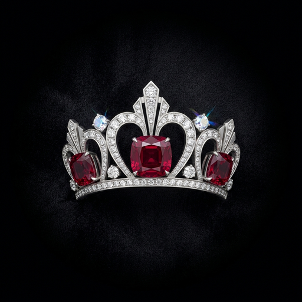

<p align="center">
  
</p>

<h1 align="center">JEWEL QUEEN — Gallery Archive</h1>

<p align="center">
  <strong>Play live on mobile or desktop:</strong> <a href="https://aparente.github.io/jewel-queen/">https://aparente.github.io/jewel-queen/</a><br />
  <em>A private gallery game made by &amp; for family — inspired by Connie Parente (<strong>Whatnot <a href="https://www.whatnot.com/user/jewelqueen">@jewelqueen</a></strong> · <strong>Instagram <a href="https://www.instagram.com/parenteconnie/?hl=en">@parenteconnie</a></strong>).</em>
</p>

---

## What's Live Today (`main`)

- **45 Real Victoria & Albert Museum (V&A) Jewels across 8 Cohesive Gallery Rooms** — zero cross-era anachronisms or duplicates across rooms:
  1. **1895–1910 · Art Nouveau: Enamel & Opal** *(René Lalique, Marcus & Co., Child & Child)*
  2. **1920s–30s · Art Deco: Geometric Contrast** *(Cartier, Raymond Templier, Georges Fouquet)*
  3. **1920s–30s · Art Deco: Tutti Frutti & Florals** *(Ostertag Paris, Parisian Deco Flower Baskets)*
  4. **1930s–50s · Surrealist & Figural Menagerie** *(Cartier Coral Hand, Owl & Guard, Paul Flato, Elisabeth Treskow)*
  5. **1940s–50s · Golden Age & Christian Dior** *(Christian Dior by Mitchel Maer, Tiffany & Co., Trifari)*
  6. **1960s · Swinging 60s Sculptural Gold** *(Andrew Grima, Jean Schlumberger, John Donald, Arthur King, Kenneth Jay Lane)*
  7. **1850–1900 · Victorian & Renaissance Revival** *(The Canning Pearl Merman, Castellani, Arthur Giuliano)*
  8. **2000–2022 · 21st-Century Masterworks** *(Wallace Chan, Cindy Chao, Boucheron, Stephen Webster, Giovanni Corvaja, Jane Short MBE)*
  - Plus Henri Lavabre's 1913 **Ruby & Diamond Royal Tiara** as the Match-5 Crown Sovereign wild.
- **teamLab Borderless × Museum Gallery Aesthetic:** Pure gallery black with a custom zero-dependency **WebGL GLSL liquid-light & chromatic shockwave shader** (`js/webgl-gallery.js`), **Pure Black Velvet Collector's Tray**, borderless HUD, smoked-glass **Curator's Vault Draw**, and faceted **cut-gemstone rain** (diamonds, emeralds, rubies, sapphires, amethysts, and pearls).
- **Welcome Invitation, Login Greeting & Expanded 6-Step Interactive Tutorial (`js/tutorial.js`):** First-visit museum invitation modal (`?welcome=1`) explaining all rules at a glance with 1-tap guided tour or quick sign-in, personalized login welcome toast upon authentication, and a hands-on 6-step tutorial covering Match 3 + Goals, forging a Match-4 Light Beam, actually firing the Light Beam across a row, pulling Vault Draw, 3× Loupe & 8 Eras, and sharing your Estate Vault (replayable anytime via `?` or `?tutorial=1`).
- **3× Jeweler's Loupe & My Collection Pokédex (`js/history.js`):** Hold any jewel on the board (or tap any card) to zoom up to 3×, pan, read its materials & provenance, open the official V&A archive record, track Estate Valuation (`$`), and pin a 5-piece **Signature Lineup**.
- **Built for Virality on TikTok, Instagram, Facebook & Whatnot (`js/share.js`, `assets/og-card.jpg`):**
  - `1200×630` Open Graph preview card for Facebook, Messenger, WhatsApp & iMessage.
  - 1-tap **9:16 TikTok / Story (`1080×1920`)** and **4:5 IG / Facebook (`1080×1350`)** **Shareable Vault Card PNGs** displaying the collector's Name, optional **Whatnot `@handle`**, Estate Value, Acquired count (`/45`), Best Score, Top 5 Velvet Tray, and Connie Parente's `@jewelqueen` / `@parenteconnie` colophon.
  - 1-tap **Copy Viral Caption + `#hashtags`** (`#vintagejewelry #antiquejewelry #whatnot #jewelqueen ...`) and personalized Challenge Invite URLs (`?invite=...&wn=...&estate=...`).
- **Collector Passport & Live Supabase Cloud Sync (`js/auth.js`, `js/supabase-config.js`, `supabase/schema.sql`):** Connected to Supabase (`pxohihigptyrsfvvowwa`) with Row-Level Security on `collector_profiles`. Instant **Email Magic Link** sign-in, cross-device Estate Vault sync, and the live **Collectors' Leaderboard** (with clickable Whatnot `@handle` links) are active now; **Google & Facebook OAuth** buttons are wired and activate as soon as OAuth Client IDs are toggled on in Supabase Auth Providers.
- **WCAG 2.2 Level AA Accessible + Automated Post-Commit Skill & Hook:** Pinch-to-zoom & 200%-zoom scroll reflow (`1.4.4`, `1.4.10`), full keyboard playability on the 7×7 board (roving `tabindex`, Arrow keys, `Enter`/`Space` select-and-swap, `I` for Loupe), non-drag arrow pan buttons & keyboard shortcuts in the 3× Loupe (`2.5.7`), all interactive targets ≥ `24×24px` (`2.5.8`), AA text (`≥ 5.7:1`) & UI border (`≥ 4.0:1`) contrast (`1.4.3`, `1.4.11`), unified `:focus-visible` rings, labelled inputs, and semantic ARIA across all 7 dialogs — continuously enforced by the workspace skill (`.agents/skills/wcag22-accessibility-check/`) and post-commit hook (`.githooks/post-commit` + `.agents/hooks.json`) that auto-fixes deterministic regressions and re-commits cleanly with `[skip-a11y]`.

---

## Upcoming Features & Roadmap

### 1. Finish Toggling On Google & Facebook OAuth Providers *(Next Up)*
- [x] Supabase project (`jewel-queen` · `pxohihigptyrsfvvowwa`) created, `collector_profiles` RLS migration applied (0 security advisor issues), Publishable key wired, and instant Email Magic Link sign-in + Leaderboard live.
- [x] In [Supabase Auth URL Configuration](https://supabase.com/dashboard/project/pxohihigptyrsfvvowwa/auth/url-configuration), set **Site URL** to `https://aparente.github.io/jewel-queen/` and added `https://aparente.github.io/jewel-queen/**` to **Redirect URLs**.
- [ ] In [Supabase Auth Providers](https://supabase.com/dashboard/project/pxohihigptyrsfvvowwa/auth/providers), paste your Google Cloud OAuth Client ID/Secret (and optional Meta Developer Facebook App ID/Secret) using callback URL `https://pxohihigptyrsfvvowwa.supabase.co/auth/v1/callback`.

### 2. Gameplay, Product & Growth Analytics
- [ ] Instrument lightweight, privacy-friendly event & performance analytics (funnel drop-off across Welcome → Tutorial → Era completion, Share Card conversions, `?invite=` viral K-factor, Loupe & Vault Draw engagement, WebGL/frame-rate telemetry, and retention cohorts) to guide gameplay tuning, feature prioritization, and monetization strategy.

### 3. Customizable Collector Trays & Gallery Backgrounds
- [ ] Surface an in-gallery tray material switcher so players can toggle between **Pure Black Velvet** (default), **Living Black Opal** (already prototyped on branch `tray/living-opal` / tag `checkpoint/v1.3-living-opal-tray`), and future velvet/mineral finishes.

### 4. Collector Virality & Community Features
- [ ] **Daily Curated Exhibition Challenge:** One shared daily board & featured V&A grail so collectors in Facebook & Instagram groups can compare scores on the exact same tray.
- [ ] **Public Shareable Vault Page (`?vault=<handle>`):** Let friends inspect another collector's full pinned 5-piece Signature Lineup in 3× Loupe zoom.
- [ ] **Optional "Shop Connie's Real Vault" Showcase:** Standalone off-platform browse drawer linking Connie's real Whatnot `@jewelqueen` vintage pieces (strictly separate from live-show gameplay to stay 100% compliant with Whatnot policies).

### 5. Experimental Game Mode Branches *(Shared 45-Piece V&A Core)*
See [`CHECKPOINTS.md`](CHECKPOINTS.md) for all saved checkpoint tags and planned spin-off branches:
- [ ] `game/pokemon-collector` — Estate auction pulls, rarity drops, appraisal mini-games & Fantasy Lineup scoring
- [ ] `game/jewel-asteroids` — Mobile arcade spin collecting drifting museum jewels across black velvet space
- [ ] `game/maximalist-slots` — 5×3 museum slot cabinet with cascading jewel reels & collector jackpots

### Recently Completed
- [x] **App Logo, Favicons, Privacy Policy & Terms of Service:** Custom museum tiara icon (`assets/app-logo-512.png`, `120×120` Google OAuth icon, `apple-touch-icon.png`, `favicon-32.png`) plus gallery-styled [`privacy.html`](privacy.html) and [`terms.html`](terms.html) covering OAuth Limited Use, analytics telemetry, data deletion, V&A attribution, and future monetization flexibility.
- [x] **WCAG 2.2 Accessibility Skill & Post-Commit Auto-Fix Hook:** Packaged the accessibility audit as a reusable Antigravity skill (`.agents/skills/wcag22-accessibility-check/`) and wired both a Git `post-commit` hook (`.githooks/post-commit`) and Antigravity lifecycle hooks (`.agents/hooks.json`) to run after every commit, auto-fix deterministic WCAG 2.2 regressions, and re-commit without looping.
- [x] **Welcome Invitation, Login Greeting, 6-Step Hands-On Tutorial & 9:16 TikTok/Story Share Cards (`checkpoint/v2.5-viral-onboarding`):** First-visit museum invitation, personalized login welcome toast, 6-step tutorial (including firing a forged Light Beam), 9:16 (`1080×1920`) + 4:5 (`1080×1350`) Vault Cards, and 1-tap viral caption + hashtags.
- [x] **Live Supabase Cloud Sync & Instant Email Magic Link:** Dedicated `jewel-queen` project (`pxohihigptyrsfvvowwa`) with verified RLS and 0 security warnings.
- [x] **WCAG 2.2 Level AA Accessibility Pass (`checkpoint/v2.4-wcag22-aa`):** Pinch-zoom & scroll reflow, keyboard playability on the 7×7 board, non-drag 3× Loupe pan controls, ≥ `24×24px` target sizes, AA text & UI border contrast, `:focus-visible` rings, and full ARIA/dialog semantics.
- [x] **Whatnot Social Integration (`@jewelqueen`):** Optional collector Whatnot `@handle` field on Vault Cards & Leaderboard + clickable Connie Parente `@jewelqueen` & `@parenteconnie` links.
- [x] **Interactive 4-Step Tutorial & Viral Vault Share Card (`checkpoint/v2.3-tutorial-share-sso`):** Guided onboarding, `1080×1350` IG/FB Vault Card PNG generator, `1200×630` Open Graph card, and Supabase Facebook/Google SSO layer.
- [x] **45 Cohesive V&A Museum Jewels (`checkpoint/v2.2-cohesive-exhibitions`):** 8 stylistically unified era rooms with zero anachronisms.

---

## Local Development

```bash
# Enable tracked Git post-commit WCAG 2.2 accessibility hook (once per clone)
git config core.hooksPath .githooks

# Run the WCAG 2.2 accessibility skill checker manually anytime
node .agents/skills/wcag22-accessibility-check/scripts/wcag22_check.mjs

# Start local preview server
python3 -m http.server 8765 --directory .
# Open http://localhost:8765/
```

See [`CHECKPOINTS.md`](CHECKPOINTS.md) for the full checkpoint history (`checkpoint/v1` through `checkpoint/v2.4-wcag22-aa`).
